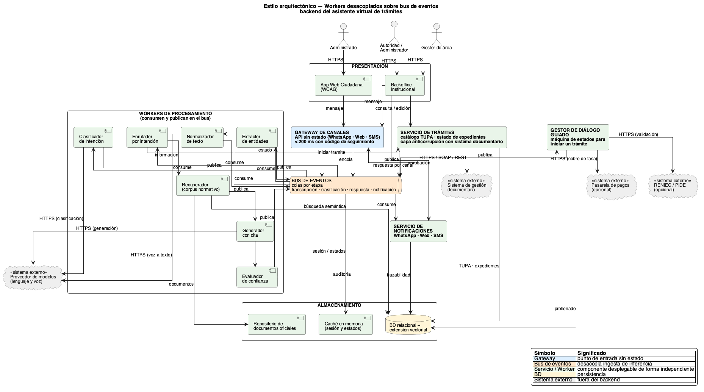
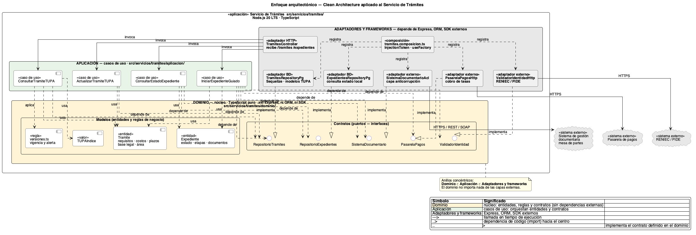

# Diseño del sistema

Esta sección contiene los recursos visuales del diseño arquitectónico. Los documentos explicativos están en [Arquitectura](../arquitectura/arquitectura-inicial.md); aquí se conservan las previsualizaciones y los archivos fuente editables.

## Arquitectura del sistema

Diagrama general de actores, presentación, gateway, bus de eventos, servicios, datos e integraciones externas.

Fuente Mermaid: [arquitectura_sistema.mmd](diagramas/arquitectura_sistema.mmd)

## Estilo arquitectónico

Vista de workers desacoplados y comunicación mediante bus de eventos.

Fuente PlantUML: [estilo.puml](diagramas/estilo.puml)

## Enfoque arquitectónico

Vista de Clean Architecture aplicada al Servicio de trámites.

Fuente PlantUML: [enfoque.puml](diagramas/enfoque.puml)
